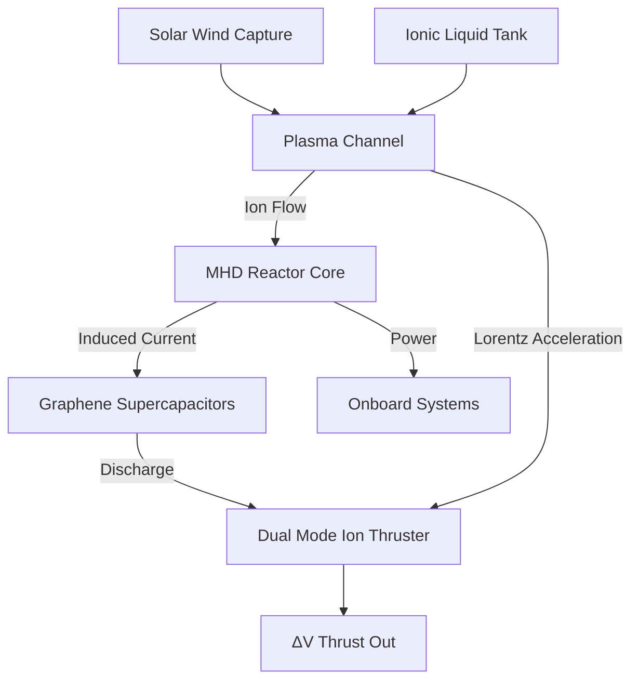
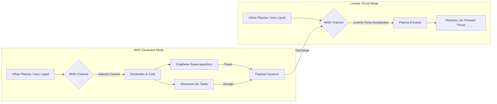
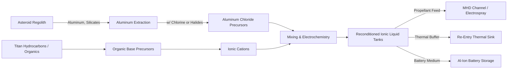

# Overby Industries
<!-- Overby Standard Badges -->

> **Honesty • Honour • Courage • Commitment**

**Towards Open, Direct Democracy**

# Our Mission 

> **Ethical • Sustainable • Zero‑Waste ISRU Space Industry**

Overby Industries is building the sustainable backbone of humanity’s future in space.  
Our focus is on **ethical, zero‑waste in‑situ resource utilization (ISRU)** to power the next century of exploration and construction.

- Metals from asteroids (nickel, iron, PGMs).  
- Concrete & composites from regolith & silicates.  
- Hydrocarbons from Titan for plastics & fuel.  
- Every process, **zero debris, zero waste**.  

We aren’t just mining rocks. We’re designing the **industrial ecosystem** to move human civilization **beyond Earth**, responsibly.

> **Where we are right now:** a software company working toward a hardware future. For the next few years we are building fleet software, open protocols and safety logic in the open, and simulating vehicles before any are built. Aerospace hardware comes later. See [Software First, Hardware Later](#software-first-hardware-later).

---

## Core Philosophy
- **Ethics First** – No exploitation, no orbital junk, no shortcuts.  
- **Openly Collaborative** – Code, automation logic, and systems are developed in the open.  
- **Multi‑path Contributions** – Everyone can help, whether through funds, code, or knowledge.  
- **Fail‑Safe Engineering** – Robust control systems, redundancy, resiliency.  
- **Software First, Hardware Earned** – Systems are written, simulated and tested in the open before anything is built in metal.  

This project is more than technology. It’s a **movement**.

## Software First, Hardware Later

**Aerospace hardware is deferred, not abandoned.** For the next few years Overby Industries is a software organization. We are building the fleet software, open protocols, safety logic and simulations that every later hardware mission depends on, and we are building them in the open. The first hardware phase, the experimental amateur-built aircraft, now starts after that foundation is proven rather than before it. Nothing from Overby has flown yet, and nothing here should be read as saying otherwise.

### Why software first

- **Most of a fleet is software.** Coordinating vehicles across light-delay, navigating without GPS, reporting what happened, and deciding what to do when a link drops need no hangar, and all of it can be built and tested thoroughly on the ground.
- **Hardware depends on it.** A vehicle that cannot report, be coordinated, or fail safely is not ready to fly, however good its airframe is. Getting this layer right first removes risk from every hardware phase.
- **It is open and cheap to check.** Code, specifications and test suites can be reviewed and rerun by anyone, and a simulated fault costs nothing.
- **Designs mature before metal.** Propulsion sizing, flight dynamics and control logic can be explored in simulation first, so what eventually gets built is informed by what simulation could not break.

### What we are building now

| Layer | What it is | Status | Repos |
|---|---|---|---|
| Fleet coordination | A coordinator and an on-vehicle agent that keep a fleet working through light-delay, link outages and vehicle faults | First working slice, in simulation | [`starlifter-os`](https://github.com/Overby-Industries/starlifter-os) |
| Open protocols | OTF-1 (telemetry and fleet messages), OTB-1 (business transparency) and OTP-1 (a tamper-evident public record) | Drafts, each with a reference implementation and tests | [`telemetry-protocol`](https://github.com/Overby-Industries/telemetry-protocol), [`transparency-protocol`](https://github.com/Overby-Industries/transparency-protocol), [`overby-transparency-protocol`](https://github.com/Overby-Industries/overby-transparency-protocol) |
| Vehicle and facility control | A mining-pod state machine, surface outpost and depot software, GPS-free navigation | Early | [`miner-automation`](https://github.com/Overby-Industries/miner-automation), [`outpost-core`](https://github.com/Overby-Industries/outpost-core), [`satnav-swarm`](https://github.com/Overby-Industries/satnav-swarm) |
| Decision support | A deterministic tier for time-critical hazards, and a human-reviewed AI advisory tier for everything else | Designed, with early code | [`starlifter-os`](https://github.com/Overby-Industries/starlifter-os), [`ai-roundtable`](https://github.com/Overby-Industries/ai-roundtable) |
| Reclamation | A debris registry and capture-technology research | Research | [`space-reclamation`](https://github.com/Overby-Industries/space-reclamation) |
| Simulation and design | Propulsion sizing, an orbital-drag and thruster simulator, aerodynamics, a flight simulator and a governance sandbox | Analysis, sizing and simulators | [`power-and-propulsion`](https://github.com/Overby-Industries/power-and-propulsion), [`ion-propulsion-simulator`](https://github.com/Overby-Industries/ion-propulsion-simulator), [`design-studies`](https://github.com/Overby-Industries/design-studies), [`helga-flight-sim`](https://github.com/Overby-Industries/helga-flight-sim), [`aevoria-simulator`](https://github.com/Overby-Industries/aevoria-simulator) |

### What is deferred

Building and flying aircraft or spacecraft: the E-AB build, propulsion test articles, flight tests and anything orbital. Concept, sizing and analysis work continues on paper and in simulation, and bench rigs (microcontroller boards and sensors) are in scope for testing control logic.

### Hardware begins when

At a minimum:

1. The fleet software runs a simulated multi-vehicle mission end to end over the open protocols, through link loss, vehicle faults and a node that never comes back.
2. The time-critical safety tier (Tier 0, the deterministic layer that handles hazards with no AI or human approval in the loop) is specified, built and tested.
3. The vehicle and pod controllers have run on bench rigs with injected faults.
4. The first hardware phase is funded.

These are working criteria and will be refined in the open.

# GPT-5 Independent AI Analysis – Scientific Validity of Overby Industries Concepts

> **Long-range concepts, not the near-term build.** The hardware described below is where the software is heading. For the next few years the work is [software first](#software-first-hardware-later). This review checks whether the concepts are scientifically plausible, not when they will be built.

This review compares Overby Industries’ vision against real scientific studies and space agency research.

## Dustless Mining & Containment Bags
- Overby Concept: Mining rigs anchored to asteroids with expandable containment bags to capture debris.
- NASA Parallel: The Asteroid Redirect Mission (ARM) studied “bagging” small asteroids as a containment and capture technology.
  - Conclusion: Supported. Tested concept; logical application for zero-pollution mining.

## Ion Propulsion & Magnetohydrodynamic Systems
- Overby Concept: Dual-mode ion thrusters (space + atmospheric ABEP) and MHD-Lorentz drives powered by solar wind capture.
- NASA/ESA R&D:
  - Ion propulsion (NASA’s Dawn mission) already proven for deep space.
  - Air-Breathing Electric Propulsion (ABEP) has been tested at ESA for harvesting residual atmosphere in LEO.
  - Magnetosail / Electric Sail concepts (Janhunen, Pekka 2006; NASA Innovative Advanced Concepts (NIAC)) propose using solar wind particles for thrust and power.
    - Conclusion: Strongly supported, expanding on existing experimental propulsion concepts.

> The Overby propulsion core operates as a dual‑function magnetohydrodynamic (MHD) channel in which a conductive working medium—either plasma generated from captured solar wind ions or vaporized ionic‑liquids—is > accelerated through a strong magnetic field. According to Faraday’s law, motion of charged particles through the orthogonal magnetic field induces current picked up across electrodes, enabling electricity
> harvesting. By adjusting electrode polarities and coil geometries, the same Lorentz force that resists charge motion in generator mode can be flipped to accelerate plasma out of the channel, producing thrust. > Thus the MHD stage is both a generator and an accelerator: in generator mode it extracts current from ionized flow to charge graphene supercapacitors and aluminum‑ion battery tanks; in thruster mode it dumps
> stored current back across the coils to push the ions to high exhaust velocity. This architecture effectively couples power generation and propulsion into a single loop, allowing “endless trickle” capture from > solar wind plus burst‑mode thrust for maneuvers.

## Ionic Liquids as Energy Storage and Propellant
- Overby Concept: Ionic liquids used for batteries, propellant, and thermal shielding.
- Scientific Basis:
  - Ionic liquids are a well-studied class of electrolytes: nonvolatile, flame-resistant, high thermal stability (used in molten salt reactors, flow batteries).
  - NASA has studied Ionic Liquid Ion Sources (ILIS) for micro-propulsion.
  - Thermal buffering with molten salts is already used in concentrated solar power → credible dual-use function in spacecraft.
    - Conclusion: Supported; multifunctional use of ionic liquids matches current R&D directions.

## ISRU Materials (Metals, Concrete, Plastics)
- Overby Concept: Metals from M-class asteroids, silicates for concrete/ceramics, Titan hydrocarbons for plastics and polymers.
- NASA/ESA Studies:
  - 16 Psyche Mission (NASA, 2022+): Exploring metallic asteroid composition directly.
  - Lunar regolith concretes studied since Apollo → sulfur and geopolymer concretes both proven.
  - Basalt fiber reinforcement also studied from Lunar/Martian regolith.
  - Titan hydrocarbons: Cassini mission confirmed seas of methane/ethane on Titan’s surface → plausible large-scale extraction.
    - Conclusion: Supported; each ISRU resource stream already validated by data and early experiments.

## Reusable Shuttle Architecture (Aircraft-Style Take-off and Landing at Exsisting Airport Infrastructure)
- Overby Concept: Starlifter II → reusable powered flight shuttle / deep space transport with integrated power / propulsion unit.
- Engineering Parallels:
  - Space Shuttle Orbiter already demonstrated runway-capable reentry.
  - Modern concepts (e.g. Sierra Nevada’s Dream Chaser spaceplane) continue that line.
    - Conclusion: Supported; ambitious but evolutionary from proven designs.

## Overall Assessment
Overby Industries’ concepts are scientifically sound and align with decades of NASA, ESA, and academic space R&D. While execution will demand major engineering breakthroughs and investment, the core principles (dustless asteroid mining, ion/Lorentz propulsion, ionic liquid energy storage, ISRU concretes, Titan hydrocarbons) are credible and based on real research.

## Why This Matters
This vision isn’t just “sci-fi” — it is a carefully reasoned integration of existing aerospace, chemistry, and ISRU research into a scalable economic model. If achieved, it represents one of humanity’s best chances for:
- Removing destructive industry from Earth.
- Building sustainable space habitats.
- Creating a zero-waste interplanetary economy.

## Repo Structure

Here’s the digital “shipyard” of Overby Industries, grouped by what each repo is for. Statuses describe what is on each repo’s main branch today; each repo’s own README is the source of truth.

### Fleet software (the current focus)

- **[`starlifter-os`](https://github.com/Overby-Industries/starlifter-os)**  
  Custom distributed operating system for fleets (miners, satellites, Starlifters) — the fleet-level layer that coordinates vehicles which each run their own local control software.
  *First working slice: a coordinator and an on-vehicle agent that talk only in OTF-1 packets, exercised by a deterministic simulation of light-delay, link outages and vehicle faults. Not flight software yet.*

- **[`miner-automation`](https://github.com/Overby-Industries/miner-automation)**  
  Automation for drills, crushers, containment bags and refinery pods.
  *A working mining-pod state machine for Arduino Uno and ESP32, with redundant (2-of-3) containment-seal voting before drilling can start. Refining, manufacturing and agriculture automation are designed, not built.*

- **[`satnav-swarm`](https://github.com/Overby-Industries/satnav-swarm)**  
  Autonomous satellite navigation for cislunar and asteroid belt operations, where GPS doesn’t reach.
  *Early software: position fixes from inter-vehicle ranging, swarm localization and close-approach screening. Star-tracker and optical navigation are not built.*

- **[`outpost-core`](https://github.com/Overby-Industries/outpost-core)**  
  Systems software for surface outposts and repair depots.
  *Early software: docking and handoff scheduling, a solar-and-battery power budget, and an OTF-1 depot node. Life support is out of scope until crewed plans firm up.*

- **[`ai-roundtable`](https://github.com/Overby-Industries/ai-roundtable)**  
  Multi-agent AI deliberation layer (Jaseci/Jac) for non-urgent fleet decisions. Humans approve its recommendations, and time-critical hazards never pass through it.
  *Early: the advisory request and recommendation formats are defined and the deliberation engine is being built.*

- **[`space-reclamation`](https://github.com/Overby-Industries/space-reclamation)**  
  Overby Industries sets the Space Zero-Waste Standard:
    - Dustless containment bags for all surface mining → no uncontrolled debris.
    - Reclamation mode built into every miner pod.
    - Closed-loop processing: every waste stream becomes shielding, aggregate, or other secondary use.
    - Transparency: operations certified by an “Overby Sustainability Code” available for public view.
      - Overby will prove that industry and ecological stewardship can coexist — even in space.

    *Research phase: a debris-tracking registry schema, a capture-technology survey with sources, and a bridge between registry entries and OTF-1.*

### Open protocols

- **[`telemetry-protocol`](https://github.com/Overby-Industries/telemetry-protocol)**  
  OTF‑1 — the open telemetry format tying together Overby's mining, debris-reclamation and certification data, and the packets a fleet coordinator and its vehicles exchange.
  *JSON Schema, a C++ reference implementation, a validator and tests; open for consultation.*

- **[`transparency-protocol`](https://github.com/Overby-Industries/transparency-protocol)**  
  OTB‑1 — the open JSON schema for publicly reporting Overby's expenditures and infrastructure investments.
  *Draft: JSON Schema, a C++ reference implementation, a validator and tests.*

- **[`overby-transparency-protocol`](https://github.com/Overby-Industries/overby-transparency-protocol)**  
  OTP‑1, the Overby Ledger — a free, append-only, tamper-evident public record that does not use a blockchain.
  *Draft: C++17 with no dependencies, adversarial tests, and an optional bridge from OTF-1 and OTB-1.*

### Design and simulation (hardware, on paper)

- **[`power-and-propulsion`](https://github.com/Overby-Industries/power-and-propulsion)**  
  Dual-mode ion thrusters (ionic-liquids or solar-wind: space + ABEP: atmospheric) and MHD-Lorentz drives also powered by solar wind capture or ionic-liquids.
  *Design and simulation only: a C++17 sizing library for the MHD core, a shuttle flight-phase state machine with firmware, CAD starters and the design docs. No hardware.*

- **[`ion-propulsion-simulator`](https://github.com/Overby-Industries/ion-propulsion-simulator)**  
  ABEP: Ion Thrusters Simulator — an open, deterministic simulator of atmospheric drag and air-breathing electric propulsion in low Earth orbit, built to ask how much power it takes to hold altitude.
  *Early. The repo's own README says what is implemented and what has been validated.*

- **[`design-studies`](https://github.com/Overby-Industries/design-studies)**  
  Diagrams, CAD, and high-level architecture visualizations.
  *XFLR5 aerodynamics analysis for Project Helga/Starlifter II, concept sketches, and the Blender→Godot asset pipeline guide. The ~96MB of Blender source files still need Git LFS before they can move in — see that repo's `docs/asset-inventory.md`.*

- **[`helga-flight-sim`](https://github.com/Overby-Industries/helga-flight-sim)**  
  Project Helga — a flight simulator built around the Starlifter II, with real flight dynamics rather than arcade physics (Godot 4 with a C++ extension).

### Governance and ethics

- **[`code-of-universe-regulations`](https://github.com/Overby-Industries/code-of-universe-regulations)**  
  Constitution and ethical operating system for the Aevoric Commonwealth — direct democracy, transparency, and a post-scarcity governance model for space civilization.

- **[`rights-for-all-life`](https://github.com/Overby-Industries/rights-for-all-life)**  
  Open-source ethical governance framework establishing rights protections for all conscious life — biological, silicon-based, and beyond.

- **[`aevoria-simulator`](https://github.com/Overby-Industries/aevoria-simulator)**  
  Adversarial sandbox that stress-tests the Code of Universe Regulations — an asteroid-mining and governance simulator for the Aevoric Commonwealth.

### Public face, research and tools

- **[`overby-industries-pwa`](https://github.com/Overby-Industries/overby-industries-pwa)**  
  Next.js + Tailwind public site (overbyindustries.space).

- **[`whitepapers`](https://github.com/Overby-Industries/whitepapers)**  
  The living **Overby White Paper**, roadmaps, and scientific references, built from LaTeX.

- **[`free-preflight-app`](https://github.com/Overby-Industries/free-preflight-app)**  
  FreeFlight — a free, lightweight pre-flight electronic flight bag for pilots: weather by airport, nearby traffic, installable and usable offline.

- **[`asteroid-miner`](https://github.com/Overby-Industries/asteroid-miner)**  
  A small 2D asteroid-mining game (Godot 4), built alongside the larger simulators.

---

## How to Contribute

Whether you bring **funding**, **code**, or **expertise** — there’s a place for you here.

### Support the Mission  
- Donate through the [Overby Landing Site](https://overbyindustries.space#get-involved).  
- Every dollar fuels infrastructure and open-source R&D.

### Code Contributions  
- Explore the repos above.  
- Look for issues tagged **`good first issue`** for easy on‑ramps.  
- Open PRs, ask in Discussions, and help build the **OS, protocols, miner and outpost control logic, and swarm navigation**. In the software-first years the most useful contributions are tests that try to break things, protocol and schema review, simulation scenarios, and a second pair of eyes on safety logic.

### Share Expertise  
- Are you an engineer, automation expert, PLC programmer, orbital mechanic, or space ethicist?  
- Distributed-systems, embedded C++, navigation (GNC) and safety-assurance experience is especially useful now; aerospace manufacturing and flight-test experience will matter when hardware begins.  
- Email us at **founder@overbyindustries.space**  
- Join discussions, share knowledge, shape the roadmap.  

---

## Roadmap (High-Level)

> **Revision, November 2026.** Hardware used to start in Q1 2028. It now starts after a multi-year software foundation, so Phase I is rewritten around software and the hardware phases keep their order but lose their dates until Phase II is funded and scheduled. The reasoning is in [Software First, Hardware Later](#software-first-hardware-later).

- **Phase I — Software Foundations** *(Current – about 2029)*: Fleet OS, open protocols, vehicle and facility control logic, navigation, safety layers and simulation, built and tested in the open. Bench rigs only (microcontroller boards and sensors): no aircraft or spacecraft hardware. Design, CAD and aerodynamics analysis continue on paper. Development is documented openly in write-ups and videos.
- **Phase II — Experimental Amateur Build** *(after Phase I; indicative start about 2030)*: Rent hangar space, build E‑AB aircraft and propulsion systems. Ground tests, taxi tests.
- **Phase II.5 — Proof of Concept** *(date TBD)*: Fly a 1:6 scaled manned E‑AB test vehicle. Validate propulsion systems, avionics, and flight software.
- **Phase III — Low Orbit Demo** *(date TBD)*: First suborbital mission — validate ISRU sensor packages and mining instrumentation in a real space environment.
- **Phase IV — Near Earth Operations** *(date TBD)*: Deploy a small orbital platform. Begin debris-capture experiments, establish first profitable debris-capture contracts, build relationships with space agencies and commercial operators.
- **Phase V — Industrial Pilot** *(date TBD)*: Operational Starlifter II fleet. Lunar depot established. First profitable asteroid returns.
- **Phase VI — Expansion** *(date TBD)*: Asteroid belt exploitation, UHPC space construction, Mars staging posts established.
- **Phase VII — Titan Era** *(date TBD)*: Titan base begins extracting hydrocarbons for plastics and fuels. Full ISRU integration. Overby Certification becomes a global standard.
- **Phase VIII — Solar Civilization** *(date TBD)*: Closed-loop resource economy across the Solar System.

Earlier versions of this roadmap placed Phase V in the 2030s, Phase VI in the 2040s, a Titan base around 2050 and a solar-system economy around 2060. Treat those as long-range aspirations rather than commitments; they will be re-dated once hardware begins.

All phases beyond Phase I remain **TBD, requires funding.**

---

## Community

- Website: [overbyindustries.space](https://overbyindustries.space)  
- GitHub Org: [github.com/Overby-Industries](https://github.com/Overby-Industries)  
- Email: **founder@overbyindustries.space**  
- (Optional) Discord/Matrix: coming soon…  

---

## License

All code, designs, and studies default to **open source** (per repo license file).  
White Paper & branding © Overby Industries.  

---

**"We’re not strip-mining the sky.  
We’re building a sustainable, open, interplanetary economy."**

